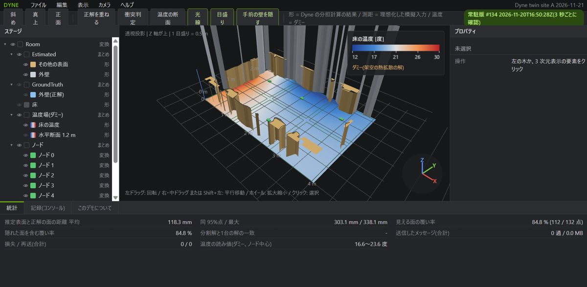

# How Dyne works

Dyne keeps a model of a physical space on the small devices placed in it. This page explains the pieces in the
order a computation goes through them. The [Physical-Edge Native Architecture](https://physical-edge-native.github.io/)
site explains the assumptions and principles behind the design.

## 1. The space is split into regions

The space (a line, a plane or a volume of grid points) is split into rectangular **regions**, one per device. A
device owns the grid points of its region and is the only one that updates them. Regions can have different sizes;
the assignment of regions to devices is currently written by hand in the configuration.

## 2. Each step, neighbours exchange only border values

At every time step a device needs, from each neighbour, the values on their shared border **from the previous step**.
It sends its own border values, waits until it has received its neighbours' values, and then computes the next step
of its whole region.

- One exchange per step, of border values only — no global communication and no central coordinator.
- A missing message is resent, and the device waits for it. Message loss therefore turns into delay, never into a
  different result.
- Wider borders are possible: with `k` layers exchanged once every `k` steps, results stay identical
  (native solvers, `--halo k`).

Inside a region, a solver may update all points directly from the previous step (an explicit scheme, as in the
finite-difference solvers) or solve its interior implicitly with the border values as boundary conditions (as in the
learned solver). Either way, only the previous step's border values cross between devices, so there is no
iteration between devices within a step. The formulas are on the [Theory](theory.md) page.

## 3. Solvers are small WebAssembly modules

A solver ("actor") is a small `no_std` Rust crate compiled to WebAssembly. It exports a handful of functions:

| Function | Purpose |
|---|---|
| `dyne_init` | set up the region (size, parameters) |
| `dyne_step` | advance the region by one step |
| `dyne_set_neighbor` | receive a neighbour's border values |
| `dyne_boundary_value`, `dyne_boundary_grad` | give the border values (and gradients) to send |
| `dyne_get`, `dyne_len` | read the state |
| `dyne_observe` | feed a measurement |

The same compiled module runs in the PC simulator and on the ESP32 devices. Why WebAssembly:

- **One binary, identical bits.** WebAssembly fixes IEEE 754 arithmetic strictly (every operation rounded
  separately, no implicit fused multiply-add). Dyne's solvers avoid the two exceptions the standard leaves
  non-deterministic (NaN bit patterns and relaxed-SIMD instructions).
- **The simulator runs the very binary that is deployed**, so a simulator run checks the deployed code, not a
  re-implementation.
- **Isolation.** A solver cannot touch memory outside its own or call anything it has not been granted — important
  when devices of different owners host each other's solvers.
- **The interface is the border contract**, so classical and learned solvers from different makers plug into the
  same place.
- **Replaceable over the air** without reflashing the firmware.

The cost is speed: the ESP32 interprets WebAssembly and emulates 64-bit floats in software (about 0.7–1.0 s per step
for the room-shape solver). Examples: `crates/heat1d-actor`, `crates/heat2d-actor`, `crates/wave2d-actor`,
`crates/sdf2d-grid-actor` (room shape), `crates/heat1d-pinn-actor` (learned). See the
[tutorial that writes a solver](guide/tutorial.md) and the [reference](guide/reference.md).

## 4. Results must match bit for bit

Because each region performs the same floating-point operations in the same order as one solver computing the
whole space, the split result is **identical, bit for bit**, to the single-solver result. This is the pass
criterion everywhere: in the simulator, on hardware, and between the WebAssembly solvers and the native PC solvers.
See [Verification](verification.md).

## 5. Devices keep the model fitted to their sensors

Each device feeds its own sensor readings into its region by **nudging**: at every observation the model value at the
sensor is pulled towards the measurement, `u ← u + γ(y − u)`. For the heat equation this never increases the
maximum error for `0 ≤ γ ≤ 2` under the usual step-size condition ([Theory](theory.md)). Examples on the devices:
distance sensors for the room shape, thermometers for temperature, accelerometers fused across devices.

## 6. Devices can stop, join and be replaced while running

- **Replacement:** the state of a stopping device (its grid values) moves to a new device, which continues; the
  result stays bit-exact (simulator).
- **Joining:** before a region joins, its neighbour closes that side with a boundary condition; once it joins, the
  border becomes an exchange.
- **Leaving:** on hardware (2026-11-21), when a device's battery was removed during a six-device room run, its
  neighbours reported the silence within about 10 s and held the run; when the battery was put back, the device
  rejoined about 40 s later.

## 7. The PC configures, watches and exports — it does not compute

All devices run the same firmware (`node-esp32/`); the PC gives each its role at run time over MQTT: its region,
its neighbours, boundary conditions and the solver. PC-side tools also

- synchronise the devices' clocks over Wi-Fi (round-trip measurement, as NTP does), so sensor readings carry
  comparable timestamps;
- send new solver modules to all devices over the air;
- show the twin live in a browser dashboard and export it to USD, VTK and OpenFOAM
  ([Connecting to other tools](connect.md)).

When a forecast faster than real time is needed, the plan is for a PC to join temporarily, receive the state the
devices have already fitted to their measurements (with identical bits), compute ahead with the same solvers, and
leave again.
