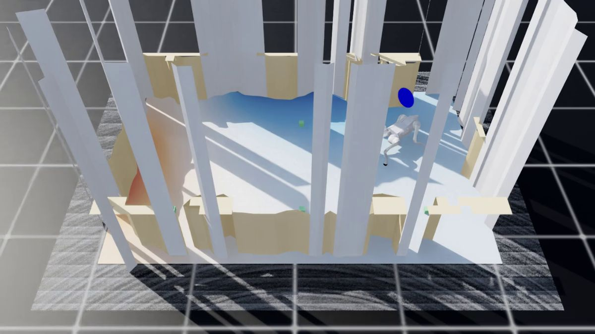
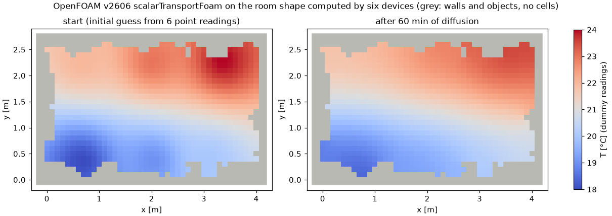

# Connecting to other tools

Dyne does not try to replace established simulators. It keeps a coarse model fitted to the sensors on the devices
and hands the state of the real space to the tools you already use.

| Target | What is exported | Use | Status |
|---|---|---|---|
| USD (Isaac Sim, Isaac Lab and other USD tools) | room shape and objects with collision shapes | robot simulation and learning in a scene that matches the real room | works with the room computed by six devices (2026-11-21): a Unitree Go2 walks in it with a pretrained policy |
| MJCF (MuJoCo) | room shape as static boxes, a floor plane, and the free floor for robot spawn points | robot simulation and learning in MuJoCo in a room that matches the real one | implemented (`dyne-mjcf`); the room tutorial's room and the real room of 2026-11-21 load in MuJoCo in CI |
| VTK image data (ParaView, PyVista) | 2D/3D field state, stored losslessly | inspection and post-processing | implemented (`--vti PATH`), read-back checked bit for bit in CI |
| OpenFOAM case (`scalarTransportFoam`) | grid, initial field, boundary conditions, given velocity and diffusivity | detailed what-if studies | implemented (`dyne-foam case`) |
| OpenFOAM case with the room's walls and furniture | cells inside walls and objects left out; their faces form the patch `walls` | the real room in a CFD study | runs with OpenFOAM v2606 on the real room of 2026-11-21 (912 cells, `checkMesh` passes) |
| OpenFOAM initial temperature from point sensors | a few readings spread over the grid (inverse-distance weighting) | start a CFD study from the measured state | implemented (`dyne-foam case --sensors`), runs with OpenFOAM v2606 |
| OpenFOAM velocity (import) | airflow computed by OpenFOAM, mapped onto Dyne's grid | the given airflow that carries temperature, CO2, humidity | implemented, checked on a synthetic file |

## Robot simulators (USD)



The shape computed by the devices is a signed distance field (distance to the nearest surface, negative inside
objects). The export turns surface lines into thick boards with colliders (walls 10 cm, furniture 5 cm) and treats
regions no sensor has observed as solid, so a robot cannot leave through a hole. `scripts/twin_live.py` writes the
USD while the devices run; `scripts/usd_check.py` checks it. The procedure for Isaac Sim and Isaac Lab with a Go2 is in
`docs/2026-11-18-isaac-go2-procedure.md` (Japanese).

## MuJoCo (MJCF)

`dyne-mjcf` writes the room shape as an MJCF file, MuJoCo's model format. It reads the same input as the OpenFOAM
export (`dyne-foam case --shape`): the `.vti` file of `dyne-sim2d` or the `shape.csv` that `scripts/twin_live.py`
writes while the devices run. It needs neither Python nor MuJoCo.

```sh
# the real room of 2026-11-21: room.xml and room_spawn.json
cargo run --release -p dyne-export --bin dyne-mjcf -- --shape shape.csv --out room.xml
# keep the robot's centre 0.3 m away from every object; boxes 1.0 m high instead of 2.4 m
cargo run --release -p dyne-export --bin dyne-mjcf -- --shape shape.csv --out room.xml --clearance 0.3 --height 1.0
```

**Frame and units.** The frame is that of the USD export: x and y are the coordinates of the shape grid, unchanged
(grid point `(i, j)` is at `origin + (i, j) × spacing`, the `x` and `y` columns of `shape.csv`, or the origin and
spacing of the `.vti` file); z points up and the top of the floor is at z = 0. Lengths are in metres, angles in
radians.

**`room.xml`.** Everything is static (directly in `<worldbody>`, no joints):

| Geom | What it is |
|---|---|
| `Floor` | a plane at z = 0 over the grid plus 0.6 m (`--floor-margin` 0.5 m and the outer boxes) |
| `Bounds_000` … `Bounds_003` | four boxes just outside the grid (west, east, south, north; `--wall-thickness` 0.1 m), so a robot cannot leave the grid |
| `Solid_000` … | grid cells where the sensors saw an object (signed distance below 0) |
| `Unobserved_000` … | grid cells no sensor has observed, treated as solid (as in the USD export; `--unobserved free` leaves them out) |

Each grid point stands for the square cell of one grid spacing around it. Solid cells are merged row by row into
rectangles (the same rule as the USD export's boxes for unobserved regions), so the count stays small: 153 boxes for
the 145 × 109 grid of the room tutorial, 51 for the 41 × 27 grid of the real room. The 2D shape has no heights,
so every box goes from the floor to `--height` (default 2.4 m); a bed or a desk is a full-height obstacle. A
`<custom>` block records the grid's extent and spacing and the box height (`dyne_grid_extent`, `dyne_grid_spacing`,
`dyne_room_height`). Gravity is −9.81 m/s² along z, sliding friction 0.8 (`--friction`).

**`room_spawn.json`.** The free floor where a robot's centre can be placed: the free grid points of the largest
connected free region (so not inside a closed pocket), at least `--clearance` metres (default 0) from every solid
cell and from the outside of the grid.

```json
{
  "format": "dyne-room-spawn 1",
  "frame": "x, y = coordinates of the shape grid (as the USD export), z up, floor top at z = 0",
  "units": "m",
  "grid": {"points": [41, 27], "origin": [0.000000, 0.000000], "spacing": [0.100000, 0.100000]},
  "clearance": 0.000000,
  "spawn_points": 912,
  "spawn_area_m2": 9.120000,
  "rectangles": [
    [0.700000, 0.100000, 0.800000, 2.400000],
    ...
  ]
}
```

Each rectangle is `[x_min, y_min, x_max, y_max]` of grid points: every grid point inside it, edges included, is a
spawn point (`spawn_area_m2` = spawn points × cell area). To pick a start, choose a rectangle, then a grid point in
it, and put the robot's base there at its standing height.

**Same input, same bytes.** Numbers are written with six decimals (1 µm, the resolution of `shape.csv`), so the same
shape gives the same files on every platform, and the `.vti` file and `shape.csv` of one run give identical files.
The CI checks this on the room tutorial's room (pinned CRC-32) and on the real room (the files in
[`docs/demo/siteA-mujoco/`](https://github.com/physical-edge-native/dyne/tree/main/docs/demo/siteA-mujoco)), then
loads both in MuJoCo (`scripts/mjcf_room_check.py`: geom count, boxes on the floor, no spawn point inside a box, a
dropped ball rests on the floor).

`scripts/twin_demo.py` and `scripts/twin_live.py` also write a `room.xml` next to the USD. That file holds the USD's
colliders (boards along the surfaces, needs the USD tools in Python); `dyne-mjcf` works from the grid alone.

## ParaView (VTK)

```sh
# write the final field of a run as VTK image data, then print each array's CRC-32
cargo run --release -p dyne-native --bin dyne-native-wave2d -- check --grid 41x41 --steps 400 --splits 1x1,2x2 --vti wave2d.vti
cargo run --release -p dyne-export --bin dyne-vti -- info wave2d.vti
```

Values are stored as raw little-endian 64-bit floats, so the file reads back bit for bit. `dyne-sim2d --vti PATH`
writes the field of a split simulator run the same way.

## OpenFOAM



Each point of Dyne's grid becomes the centre of one OpenFOAM cell, so values carry over one to one; numbers are
written in the shortest decimal form that reads back to the same 64-bit float.

```sh
# a scalarTransportFoam case from a .vti field (faces west,east,south,north[,bottom,top])
cargo run --release -p dyne-export --bin dyne-foam -- case --vti wave2d.vti --out wave2dCase --velocity 0.1,0,0 \
  --faces fixed:0,zero-gradient,zero-gradient,zero-gradient
cd wave2dCase && blockMesh && scalarTransportFoam

# the real room: shape from the devices, initial temperature from a few point readings
cargo run --release -p dyne-export --bin dyne-foam -- case --sensors readings.csv --shape shape.csv \
  --out roomCase --walls zero-gradient --end-time 3600 --write-interval 600 --delta-t 1
cd roomCase && checkMesh && scalarTransportFoam

# OpenFOAM -> Dyne: map the velocity of a CFD case onto Dyne's grid, then read it
cargo run --release -p dyne-export --bin dyne-foam -- case --vti wave2d.vti --out flowGrid
(cd flowGrid && blockMesh && mapFields ../roomFlow -sourceTime latestTime)
cargo run --release -p dyne-export --bin dyne-foam -- velocity flowGrid 0 --vti flow.vti
```

The inputs of the real-room run (the room shape and the dummy readings) and the plotting script are in
[`docs/demo/siteA-openfoam/`](https://github.com/physical-edge-native/dyne/tree/main/docs/demo/siteA-openfoam).
Results of OpenFOAM and Dyne differ by their discretisation, so comparing them needs a stated tolerance. The
mapping of boundary types and notes on the openfoam.org releases are in the API documentation of
`dyne_export::foam` (`cargo doc -p dyne-export --open`).
