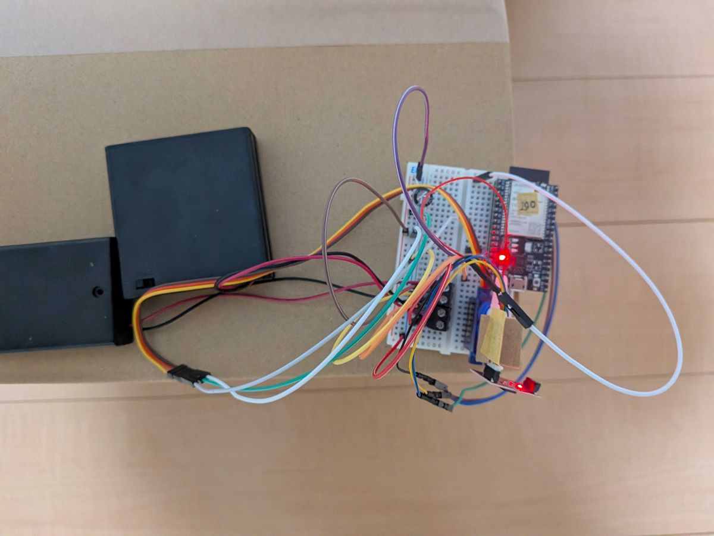

# Hardware

!!! warning "Needs hardware"
    This page needs ESP32 boards. Everything else can be tried with the simulator.

Parts used in the 2026-11-21 room run, per device: an ESP32 development board, a VL53L5CX 8×8-zone distance sensor
on an SG90-class pan servo, a breadboard, and two AA battery boxes (one for the board, one for the servo).
A Wi-Fi access point and a PC on the same network run the MQTT broker, a DHCP server and a time server.

{ width="60%" }

All devices run the same firmware (`node-esp32/`); their role is set by configuration sent over MQTT, and both the
firmware and the solver modules can be updated over Wi-Fi.
