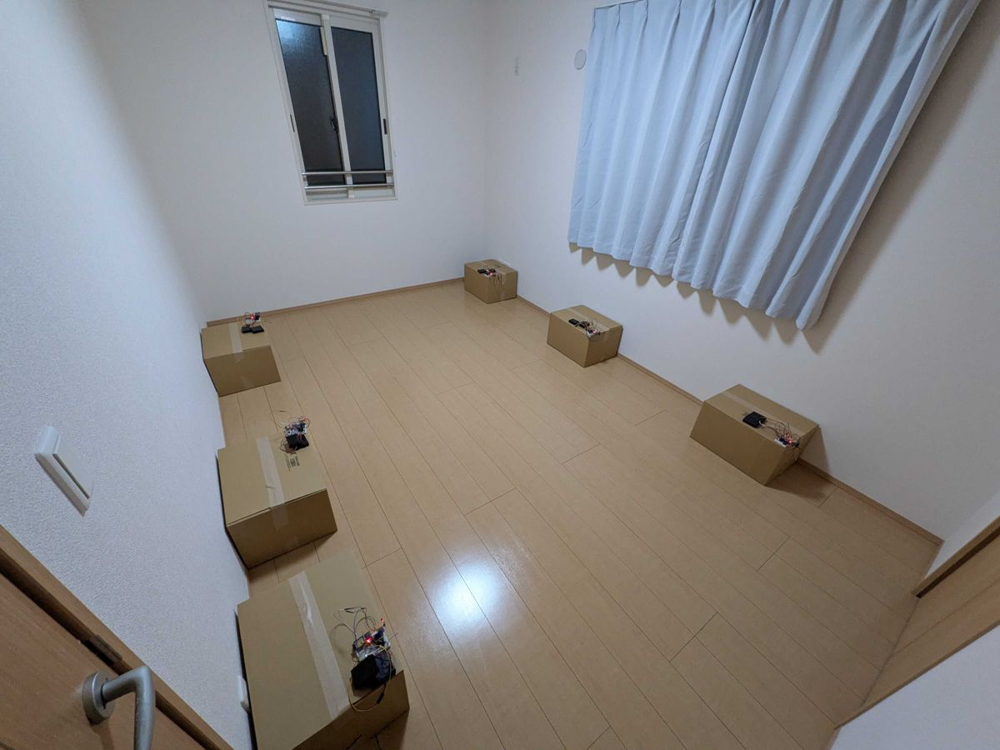
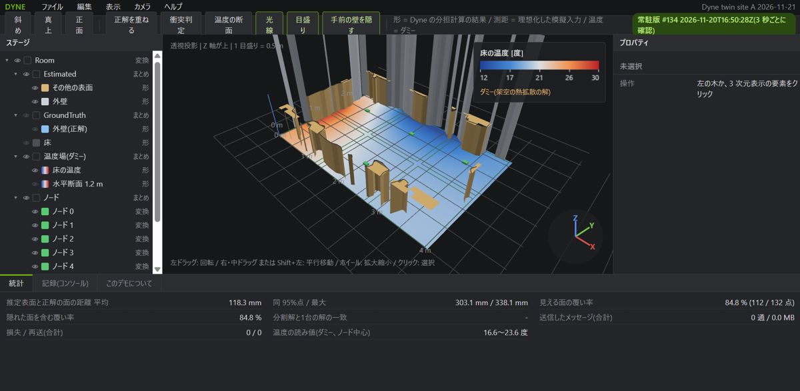

# Dyne

Dyne runs physics models (numerical solvers and small neural networks) on a group of microcontrollers placed in a
real space. Each device computes its own part of the space and exchanges only the values on the edges of its part
with its neighbours. The result is a digital twin that lives on the devices; a PC is only needed to configure,
watch and export it (to USD for Isaac Sim, to VTK for ParaView, to OpenFOAM cases).

{ width="49%" }
{ width="49%" }

!!! note "Simulator and hardware"
    Everything in these pages can be run on a PC with the simulator, without hardware. Pages that need hardware
    say so. The photos above are from a hardware run on 2026-11-21; most other figures come from the simulator.

## Where to start

| If you want to | Read |
|---|---|
| try Dyne on a PC in five minutes | [Quick start](getting-started.md), then [Installation](guide/installation.md) |
| understand the design | [How it works](concepts.md) and the [architecture site](https://physical-edge-native.github.io/) |
| see the whole pipeline without hardware | [A room from simulated sensors to USD and OpenFOAM](guide/tutorial-room.md) |
| see what runs on real devices | [A real room, end to end](tutorials/real-room.md), [The 2D wave equation](tutorials/wave-equation.md), [Status and limits](status.md) |
| write a solver | [Write your own solver](guide/tutorial.md), [Solver interface and messages](guide/reference.md) |
| run it on ESP32 boards | [Hardware](hardware.md), [Hardware guide](guide/hardware.md) |
| hand the twin to Isaac Sim, ParaView or OpenFOAM | [Connecting to other tools](connect.md) |
| know what is guaranteed | [Verification](verification.md), [Theory](theory.md) |
| ask a question or share an idea | [GitHub Discussions](https://github.com/physical-edge-native/dyne/discussions) |

Source code: [github.com/physical-edge-native/dyne](https://github.com/physical-edge-native/dyne).
Cite with the concept DOI [10.5281/zenodo.24241009](https://doi.org/10.5281/zenodo.24241009).
