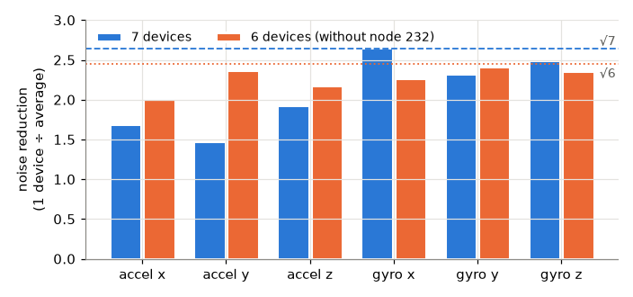
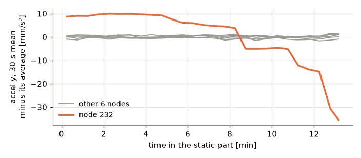

# IMU fusion on hardware (2026-11-21)

Seven devices, each with an accelerometer and gyroscope, were fixed to one plywood board and recorded together for
34 minutes. The question: when the devices' readings are averaged, does the noise fall as expected for independent
sensors (√N), and does time synchronisation matter when the board moves?

!!! note "Scope"
    This run records the sensors and analyses them on a PC. The on-device fusion solver
    (`crates/imu-fusion-actor`, neighbour-only averaging) was not running; the record can be replayed through it
    later. The record and the scripts are in
    [`measured/2026-11-21-siteA-imu/`](https://github.com/physical-edge-native/dyne/tree/main/measured/2026-11-21-siteA-imu).

## Setup

- 7 × ESP32 with an Arduino Modulino Movement (LSM6DSOX) each, taped to one plywood board; the modules were aligned
  by eye (about ±10 degrees of rotation on the board).
- Clocks synchronised to the PC's time server over Wi-Fi before recording; every sample carries the synchronised
  timestamp.
- 12.5 samples per second, sent in 1 s batches. The rate is low because each device currently publishes only about
  one MQTT message per second ([#114](https://github.com/physical-edge-native/dyne/issues/114)).
- Procedure: 13.5 min static; tilt holds of 30–130 s read with a digital angle meter
  (0.00°, 9.00°, 17.70° → 17.60°, back to 0.10°); 20 s still, 60 s of rocking by hand, 20 s still.
- Analysis: `scripts/imu_analyze.py` (after [#121](https://github.com/physical-edge-native/dyne/issues/121)), 1 s
  averages, each device's zero offset (its mean over the static part) removed first.

## Static noise versus number of devices

Noise reduction = (average standard deviation of one device's 1 s means) ÷ (standard deviation of the average over
all devices). For independent noise it would be √N.

| | accel x | accel y | accel z | gyro x | gyro y | gyro z |
|---|---|---|---|---|---|---|
| 7 devices (√7 = 2.65) | 1.69 | 1.48 | 1.92 | 2.65 | 2.33 | 2.49 |
| 6 devices, without node 232 (√6 = 2.45) | 2.01 | 2.37 | 2.17 | 2.27 | 2.42 | 2.36 |

- The gyroscopes follow √N closely.
- The horizontal accelerometer axes fell short with all seven devices. Leaving each device out in turn shows a single
  cause: without node 232 the standard deviation of the average drops from 2.0 × 10⁻³ to 4.1 × 10⁻⁴ m/s² (accel y).
- Node 232 did not drift smoothly: its accel y changed in steps, about 0.045 m/s² over 13 minutes (other devices:
  about 0.002 m/s²), which corresponds to a tilt change of about 0.26°. Its sensor had been unplugged and plugged
  in again before the run; a module shifting on the board would look like this.

- Accel z (along gravity) reaches 2.17 with six devices, below √6; the cause has not been identified.

## Tilt against the angle meter

Each device's tilt was measured as the angle between its gravity direction in a hold and in the 0° hold. This does
not depend on how the device is rotated on the board.

| Hold | Angle meter | Mean of 7 devices | Spread between devices | Difference |
|---|---|---|---|---|
| 9° | 9.00° | 8.83° | 0.29° | −0.17° |
| 18° | 17.65° (17.70 → 17.60) | 17.33° | 0.79° | −0.32° |
| back to 0° | 0.10° | 0.11° | 0.13° | +0.01° |

The estimate is about 2 % low. One known contributor: each accelerometer's zero offset lies inside the measured
gravity vector and cannot be separated from how the module sits on the board without a calibration (in the
synthetic CI record, offsets of 0.3 m/s² bias a 10° tilt by about 0.1°). The angle meter's own accuracy was not
checked.

## Rocking: synchronised timestamps versus arrival time

During 60 s of rocking (largest component: gyro y, standard deviation 0.19 rad/s), each device was compared with the
average of the other six on a common 25 Hz time grid.

| Timestamps used | Each device − average of the others (RMS) |
|---|---|
| synchronised timestamps from the devices | 0.037 rad/s |
| arrival time at the PC (batches spread back at the sample rate) | 0.066 rad/s |

With synchronised timestamps the devices agree about twice as well. The remaining 0.037 rad/s is about what the
±10° rotation of the modules on the board predicts (sin 10° × 0.19 ≈ 0.033 rad/s): with aligned modules, or with
each module's rotation estimated, it would fall further.

## Caveats

- One run, one board, one room.
- 12.5 Hz limits what the rocking test can show; faster rates need faster publishing (#114).
- Mounting rotation was not measured; only magnitudes that do not depend on it are reported for tilt.
- The neighbour-only fusion on the devices was not run in this test.
