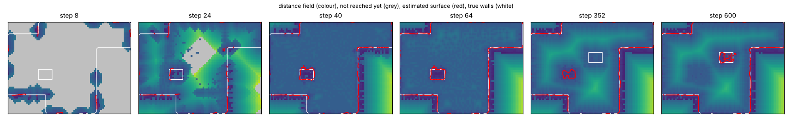
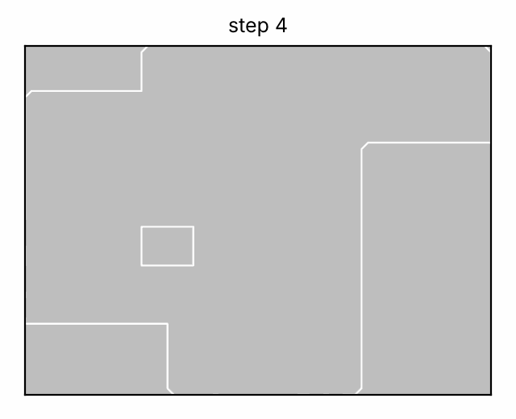
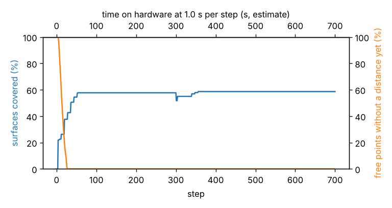

# How the room twin grows (simulator)

A room twin is not there at once. Each distance sensor sees only part of the room at a time, and what one device
has learnt reaches the others step by step. This page shows how the twin of a furnished room fills in, and how long
that takes.

!!! note "Scope"
    These results are from the simulator. The same view of the 2026-11-21 hardware run needs a published record of
    that run; this is tracked in [#161](https://github.com/physical-edge-native/dyne/issues/161). The time on
    hardware below is an estimate from the measured speed of the shape solver on an ESP32 (0.7–1.0 s per step).

## Setup

- Room: `crates/dyne-sim2d/scenes/room6_move_pan4h.txt`, about 3.6 m × 2.7 m with a desk, a bed, a bookshelf and a
  cardboard box that is moved at step 300.
- Seven distance sensors in free corners, each turned by a servo through eight directions (one full turn every
  64 steps).
- The room is split over four devices (2 × 2). The split result equals the single-device result bit for bit at every
  step.

## Snapshots



Colour is the computed distance to the nearest surface; grey marks grid points that no distance has reached yet; red
is the estimated surface and white the true walls and furniture. The box is moved at step 300. At step 352 its old
outline is still in the twin and the box at its new place is not seen yet; the old outline is gone at about step 450,
and by step 600 the twin shows the box at its new place (84 % of its surface covered, 94 % at step 700).



## Growth over time



| | Step | On hardware (estimate) |
|---|---|---|
| 50 % of the final surface coverage | 20 | about 14–20 s |
| 80 % of the final surface coverage | 36 | about 25–36 s |
| Every free grid point has a distance | 28 | about 20–28 s |
| Final surface coverage after one full turn of the servos | 57.7 % at step 64 | about 45–64 s |

"Surfaces covered" counts sample points on the true walls and furniture that have an estimated surface within one
grid cell. Surfaces that no sensor can see from its corner stay uncovered, so the final value is well below 100 %.

## Why it grows one cell per step

Every grid point is updated from its neighbours' values **of the previous step**, also across the border between two
devices. A distance therefore travels one grid cell per step (the grey area shrinks steadily in the snapshots).
The benefit of this choice: neighbouring devices exchange border values only once per step, which suits a radio
link, and the split computation performs exactly the same operations as a single device, so the result is identical
bit for bit. Using the newest values within the same step would spread faster but would need several exchanges
between devices in every step.

## Reproduce

```sh
cargo build --release -p dyne-sim2d
(cd crates/sdf2d-grid-actor && cargo build --release --target wasm32-unknown-unknown)
target/release/dyne-sim2d \
  --wasm crates/sdf2d-grid-actor/target/wasm32-unknown-unknown/release/sdf2d_grid_actor.wasm \
  --scene crates/dyne-sim2d/scenes/room6_move_pan4h.txt --px 2 --py 2 --steps 700 --quiet \
  --growth-csv growth.csv --snapshot-every 8 --snapshot-dir snaps
python scripts/twin_growth.py --growth growth.csv --snapshots snaps --out fig --panels 8,24,40,64,352,600
```

The figures for the moved box (old outline, box at its new place) come from `--track-csv`, which scores the moving box
separately. `growth.csv` has one row per step with the same measures as the final `shape:` lines of `dyne-sim2d`. Its surface
error column also counts surface points whose distance has not been computed yet, so early values can be very large;
the figures do not plot it. `scripts/ci-check.sh` (step 22) checks the coverage at steps 20, 40 and 64 against pinned
values.
