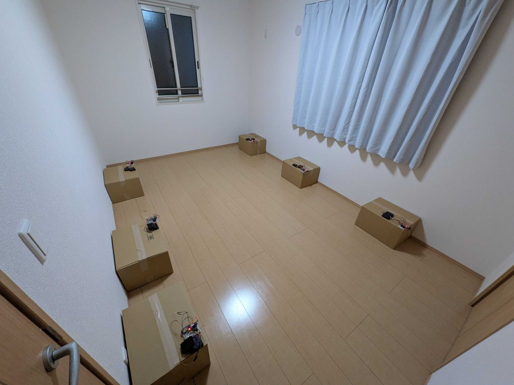
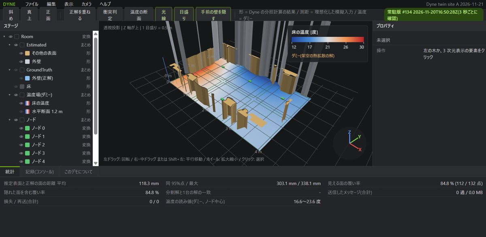
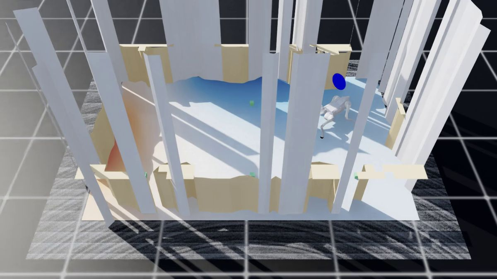
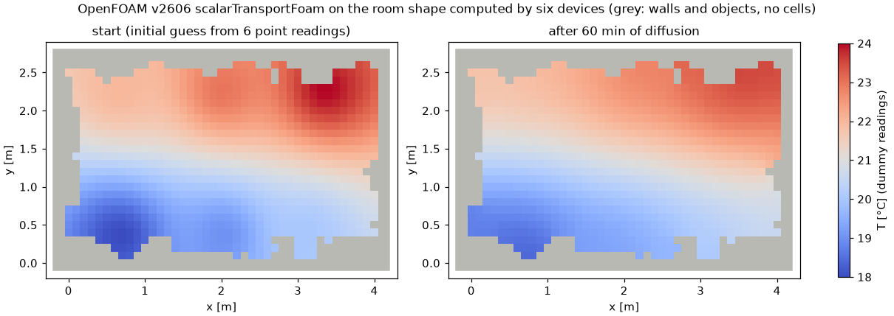

# A real room, end to end

!!! warning "Needs hardware"
    The measurements need six ESP32 devices with distance sensors. The same steps run in the simulator with a
    made-up room; see the room tutorial in the repository.

1. **Place the devices.** Six devices stand 0.35 m from the long walls of a 4.0 m × 2.6 m room, 0.27 m above the floor.
2. **Compute the shape on the devices.** The room is split into 3 × 2 parts. Each device turns its sensor readings
   into the shape of its own part and exchanges the edge values with its neighbours.
3. **Watch the twin.** The PC dashboard shows the shape as the devices compute it.
4. **Export to USD and open it in Isaac Sim.** A Unitree Go2 walks in the exported room with Isaac Lab's
   pretrained locomotion policy.

{ width="49%" } { width="49%" }

5. **Export to OpenFOAM.** `dyne-foam case --sensors readings.csv --shape shape.csv --out roomCase --walls zero-gradient`
   writes a mesh without the cells inside walls and objects; `checkMesh` and `scalarTransportFoam` run on it
   (OpenFOAM.com v2606). The initial temperatures below are dummy readings at the six device positions.

## Accuracy, honestly

| | Simulator, same room and placement | Hardware, 2026-11-21 (no calibration) |
|---|---|---|
| Mean distance from computed walls to measured walls | 7.7 mm | 49 mm (max 100 mm) |
| Including the devices' own stands | – | 120 mm |
| Visible surfaces recovered | – | 83 % |

Likely causes of the gap: the sensors see the device stands, the servo angles were not calibrated, the beam spreads,
and the devices were placed by hand. The floor colour in the dashboard is a dummy temperature field.
