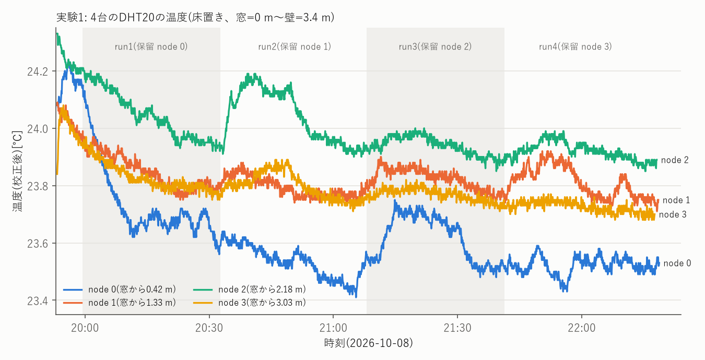
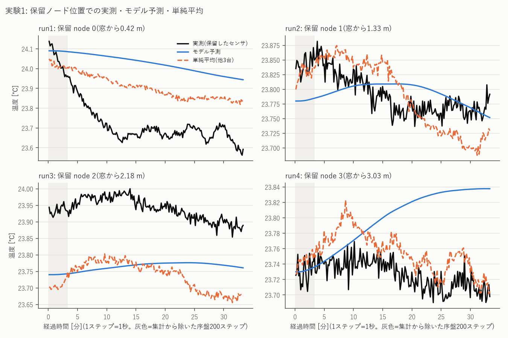

# 実験1 実機実測レポート(下書き) (docs\2026-10-09-experiment1-report.md)

**これは下書きである**(ユーザーがコミット前に手で編集する)。実施日: 2026-10-08。
当日の時刻つき記録: docs\2026-10-08-experiment1-log.md。実測CSV: measured\2026-10-08-exp1\。

## 1. 要旨

部屋の一直線上(窓=0m〜遮蔽物の壁=3.4m)に、DHT20(温湿度センサ)付きのESP32(ESPr
Developer 32 Type-C)を4台、乾電池駆動で置いた。各台が自分の担当区間の1次元熱伝導を
差分法で計算するWASMアクター(WebAssemblyで書かれた計算部品)を実行し、隣とUDPで境界値を
交換しながら、自分のセンサ値を同化(データ同化=実測値を計算に取り込んで計算結果を実測へ
寄せる処理)した。1台ずつ「保留ノード」(センサ値を同化に使わず、予測との照合だけに使う
ノード)を交代させて、約33分のrunを4回行った。

- **合否: 合格**(2026-10-08改訂後の基準=実装したファームウェアが本計測の全runを最後まで
  動き続けること)。4runとも4台が2000ステップを完走し、run中の再起動は0回。
- 記録用の指標(旧基準): 保留ノード位置での予測誤差の4run平均は、モデル0.150℃、
  他3台の実測の単純平均0.116℃(比1.29)。端のノードではモデルが不利、中のノードでは
  わずかに優位。
- 実験の途中で、合格基準を変更した(理由は§6)。実験1は、他の物理量のセンシング・
  2次元/3次元化・センサ数の増加といった今後の規模拡大に備える準備と位置づける。

## 2. 構成

| 項目 | 内容 |
|---|---|
| ノード | ESPr Developer 32 Type-C ×4(node 0〜3)。全台同一ファーム node-esp32(発注11反映版)、ノードIDは書き込み時の設定 |
| センサ | DHT20 ×4(I2C: SDA=IO21、SCL=IO22、電源=3V3)。5秒周期 |
| 電源 | 単3×3直列(約4.5V)→電池ボックス→端子台→ブレッドボードの電源ライン→VIN |
| 計算 | WASMアクター heat1d_actor_small(差分法、WAMRのインタプリタ実行)。1ステップ=実時間1秒 |
| 通信 | 制御・観測=MQTT(PC上のmosquitto)、境界値の交換=ノード間のUDP直送(40バイト)。Wi-Fiは PCのモバイルホットスポット(2.4GHz) |
| PCの役割 | 設定注入・開始/停止の号令・観測の記録のみ(run中の計算には関与しない) |

配置(窓からの距離、±0.5cm): node 0=0.425m、node 1=1.328m、node 2=2.178m、node 3=3.028m。
4台とも床置き。窓とカーテンは閉。各位置は、L=3.4mを4台で分けた担当区間の中央(モデルの
観測点)に合わせた。

本計測の設定(全run共通): 65格子点(格子幅5.3cm)、2000ステップ、dt=1秒、熱拡散率
α=1e-3 m²/s(空気の乱流混合込みの実効値の仮置き)、r=αΔt/h²=0.354(安定条件r≤1/2内)、
両端=断熱(zero_grad)、同化の強さγ=0.3、観測周期10ステップ、観測点=担当区間の中央、
校正の補正値 −0.06 / +0.13 / −0.03 / −0.04 ℃(node 0〜3)。初期温度は各run開始直前2分の
4台の補正後平均(24.09 / 23.78 / 23.74 / 23.73 ℃)。

## 3. 実施内容(時刻の詳細は実験記録)

| 段階 | 時刻 | 結果 |
|---|---|---|
| 電池駆動の初回テスト(runbook §1) | 10:39〜12:15 | node 0が電池で起動・温度取得。電池node 0+USB node 1の2台計算で **CRC(計算結果の検査値)0x3CC6AD26 / 0x8AC47DE7 がシミュレータの値と一致**(電源方式が変わっても計算は不変)。電池で約30分無再起動 |
| 書き込みと組み立て(§2) | 12:29〜18:36 | node 2・3に初書き込み。node 0・1を現行版へ再書き込み(旧版だったため。§5) |
| 校正(§3) | 18:39:39〜19:09:39 | 4台を同一地点に30分。後半15分の平均から補正値を算出し注入、ファーム側の適用を確認 |
| 温度差の確認 | 19:43〜19:48 | 計算なしで並べて測定。最大差0.31℃(センサの揺らぎの約12倍)、中央が高い山形 |
| 本計測run1〜4(§5) | 19:59〜22:15 | 4runとも完走(表1) |
| 撤収(§8) | 22:19〜22:23 | 電池スイッチOFF、ブローカーの保持設定を消去、実測CSVを measured\ へ退避 |

## 4. 結果

### 4.1 合否(改訂後の基準)

| run | 保留 | 開始 | 終了 | 完走 | run中の再起動 | 速度記録(rt)の受信 |
|---|---|---|---|---|---|---|
| 1 | node 0 | 19:59:21 | 20:32:33 | 4/4 | 0 | 4台とも20/20 |
| 2 | node 1 | 20:34:00 | 21:07:21 | 4/4 | 0 | 4台とも20/20 |
| 3 | node 2 | 21:07:58 | 21:41:18 | 4/4 | 0 | 4台とも20/20 |
| 4 | node 3 | 21:41:50 | 22:15:12 | 4/4 | 0 | 4台とも20/20 |

計算時間は約40〜41ms/ステップで、1秒周期に対して約24倍の余裕(9/18の初回実測と同水準)。
→ **合格**。あわせて、発注11で実装した機能(全域外縁の境界条件、校正の補正値、保留、
1ステップの実時間周期、初期温度、物理単位での運転)が実機で意図どおり動くことを確認した。

### 4.2 記録用の指標(旧基準)

ズレ=保留ノードのセンサ実測値(補正後)−その位置のモデル予測温度。10ステップごとに記録し、
序盤200ステップを除いた180回の絶対値の平均をとる。単純平均=他3台の実測値の平均による予測。

| run | 保留(窓からの距離) | モデル | 単純平均 | 比(モデル÷単純平均) |
|---|---|---|---|---|
| 1 | node 0(0.43m、窓際) | 0.320℃ | 0.195℃ | 1.64 |
| 2 | node 1(1.33m) | 0.028℃ | 0.039℃ | 0.73 |
| 3 | node 2(2.18m) | 0.173℃ | 0.200℃ | 0.86 |
| 4 | node 3(3.03m、壁側の端) | 0.078℃ | 0.030℃ | 2.60 |
| 4runの平均 | | 0.150℃ | 0.116℃ | 1.29 |

旧主基準(比<1)は不合格、旧副基準(±1.0℃以内)は合格。

### 4.3 温度分布

図1(figs\fig11_exp1_temps.png): 4台の補正後温度。部屋は夜にかけて冷え、**窓際(node 0)
だけが大きく下がった**(19:58→21:41で node 0 が0.67℃、他3台は約0.25℃)。分布は窓際が
最も低く、2.2m付近が最も高い山形。部屋全体の温度差は0.3〜0.5℃。

図2(figs\fig12_exp1_holdout.png): 各runの保留ノード位置での実測・モデル予測・単純平均。

## 5. わかったこと

### 5.1 モデルと同化(図2)

1. **窓が熱の逃げ場になっているのを、断熱境界の拡散モデルは表せない**(run1)。熱源も
   吸い込みもない拡散モデルは、隣より低い温度を端に作れない。node 0の予測は初期温度
   付近にとどまり、隣のnode 1の実測より高いままだった。
2. **温度の山の頂上も作れない**(run3)。node 2は両隣より暖かいが、拡散は隣の値の間を
   なめらかにつなぐだけなので、モデルも単純平均も約0.2℃低く外れた。
3. **保留区間には熱伝導でしか情報が届かず、遅い**。α=1e-3では0.9m先まで伝わるのに約13分
   (0.9²/α)かかり、初期温度の影響が長く残る。run4では、暖かいnode 2側の影響がゆっくり
   届いて、予測が実測から離れていった。
4. **同化の効きが弱い**。同化しているノードでも、モデルと実測のズレが残った(run1の
   node 1で約−0.13℃)。同化は担当区間の中央の1点を10秒ごとに30%引き寄せるだけで、
   区間全体のずれを取り切れない。
5. 端のノードの保留でモデルが不利、中で優位という構図は、設計書§1が予想していたもの
   (端は外側に観測がなく外挿になる)と一致した。

### 5.2 ハードウェアと運用

| 事象 | 原因 | 対処 |
|---|---|---|
| node 0が上から押さないと通電しない | 安価なブレッドボードで、ESP32のピンが金具の奥まで届いていなかった | 穴を広げて奥まで挿す。他3台は品質の良いブレッドボードで問題なし |
| 配置作業のたびに再起動(計10回以上) | 端子台のピンが細く、ブレッドボードから抜けやすい | 未対処(既知の問題)。run中は触らない運用で回避。保持された設定で自動復帰するため実害は小さい |
| onlineが来ない | ホットスポットの自動オフ(デバイス未接続時) | 自動オフを無効化、帯域を2.4GHzに |
| USB接続のnode 1が再起動を繰り返す | USBケーブルの不良 | 別のケーブルに交換 |
| node 0・1が旧版ファーム | 9月の書き込みのまま。ファーム名が版で変わらず気づけない | 温度メッセージの生値(temp_c_raw)の有無で判別し、再書き込み |
| 手順書の号令に `--dt 1` が抜けていた | 手順書の誤り | 号令前の試し実行(dry-run)で r=0.0000 の表示から発見。手順書を修正 |
| `--peers auto` が失敗 | 自動解決はonline状態のノードしか拾わない | IPを直接指定 |

### 5.3 観測された現象(原因未確定)

- **run開始の直後に、保留していないノードの温度が急に上がった**: 20:34(run2開始)直後に
  node 2が+0.25℃、21:08(run3開始)直後にnode 0が+0.2℃、21:42(run4開始)直後に
  node 1が+0.1℃(図1)。run開始の操作はPCからのみで、ノードには触れていないはず。
  **原因は不明**(ユーザー確認: 当時の部屋の状況からは特定できない)。ユーザーの予想は
  マイコン自身の発熱。1分平均で見ると、node 2(20:34)は号令の直後から1分で+0.09℃と
  立ち上がりが鋭いが、node 0(21:08)は号令の約2分前から上がり始めており、node 1(21:42)は
  数分かけて+0.1℃と緩やか。run間の待ちは約30秒しかなく、計算の負荷は全run・全台で
  ほぼ同じ(約41ms/ステップ)なので、「run開始で負荷が変わって発熱した」とは考えにくい。
  また、発熱なら4台とも・全runで同様に出るはずだが、上がったのは毎回1台だけだった。
  確かめる方法の案: 1台を電源ONのまま計算あり/なしで温度を比べる、センサを基板から
  離して(ジャンパ線を延ばして)比べる。
- 午前、node 0の速度記録(rt)が20通中5通しか届かなかった。夕方の全runでは再発せず。
  当時のnode 0は旧版ファームで、再書き込みで解消した可能性があるが、原因は特定していない。
- センサは床置きのため、測っているのは床付近の空気(冷気がたまりやすく、床からの伝導も
  受ける)の温度である。

## 6. 合格基準の変更と、エッジデバイスだけで実現できる範囲

当初の主基準は「保留ノード位置で、モデルの予測が単純平均より実測に近いこと」だった。
実測では部屋全体の温度差が約0.3℃しかなく、4台(保留を除けば3台)のマイコンと、
マイコンに1対1のセンサだけでは、分布推定(デジタルツイン)の優位性を示せないと判断し、
run1の後に合格基準を「ファームウェアが全runを最後まで動き続けること」へ変更した
(ユーザー決定。改訂履歴: docs\2026-08-04-dyne-spec-review.md、
docs\2026-09-21-experiment1-design.md §1)。

この結果から読み取れる限界と、次に必要なもの:

1. **情報量の不足**: 1台に1点のセンサでは、点と点の間の分布の手がかりがほとんど無い。
   1台で多数の点を測れるセンサ(例: 8×8ゾーンの測距センサVL53L5CX)や、センサの台数の
   増加が要る。
2. **モデルの表現力**: 熱源・吸い込みの無い1次元拡散では、窓の冷えや中央の暖かさを
   表せない。境界条件(窓を温度固定にする等)や、移流・熱源項を持つモデル、あるいは
   学習型アクターが要る。
3. **伝わる速さ**: 同化した情報が拡散でしか隣へ届かないため遅い。観測の無い区間を
   埋めるには、同化の方法(点ではなく区間全体を補正する等)の見直しが要る。
4. **エッジだけで動くこと自体は示せた**: 電池駆動の4台が、PCの計算に頼らずに33分×4runの
   協調計算と同化を、再起動なしで続けた。計算時間には約24倍の余裕がある。

## 7. 実測ファイルの所在

| 内容 | 場所 |
|---|---|
| 当日の時刻つき記録 | docs\2026-10-08-experiment1-log.md |
| 実測CSV(校正・run1〜4・既定記録先の一式) | measured\2026-10-08-exp1\(各フォルダの説明と監視ツールの起動時刻は measured\README.md) |
| 図 | figs\fig11_exp1_temps.(dat/png)、figs\fig12_exp1_holdout.(dat/png)、生成スクリプト figs\fig11_exp1.py |
| 手順書(当日の修正込み) | docs\2026-09-21-experiment1-runbook.md |
| 設計書 | docs\2026-09-21-experiment1-design.md |
| 配置の写真 | ユーザーが保管(リポジトリ外) |
