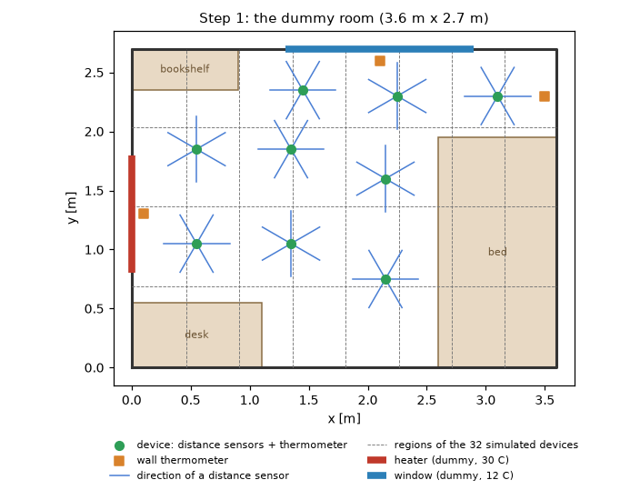
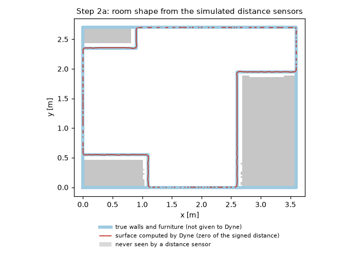
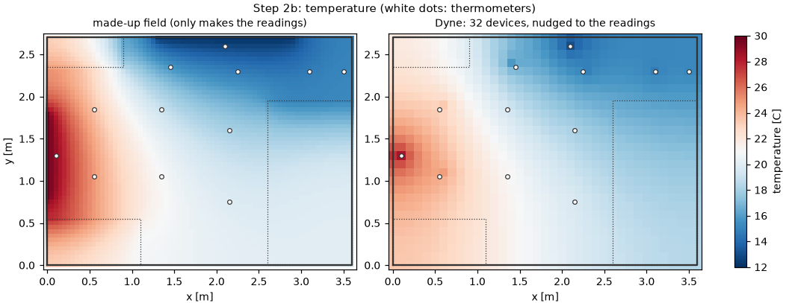
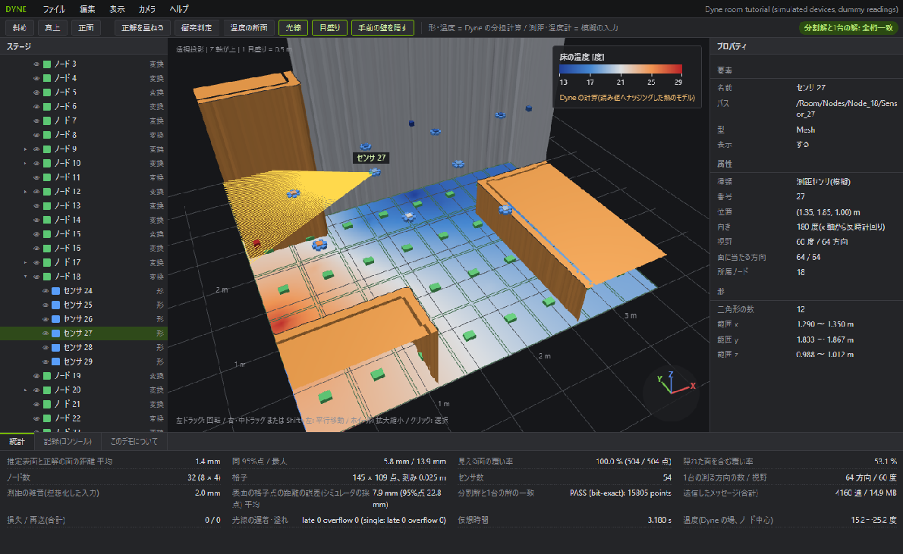
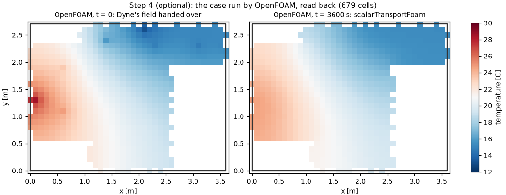

# Tutorial: a room from simulated sensors to USD and OpenFOAM

This tutorial shows what Dyne is for, end to end, without any hardware. A
dummy room is watched by 32 simulated microcontrollers ("devices"). Some of
them carry distance sensors and thermometers that produce dummy readings. The
devices split the room into regions, and each one computes the state of its
own region from the readings: the room's **shape** and its **temperature**.
They agree with each other by exchanging only the values at the borders of
their regions. The result is then written out for other tools: a USD file
with physics colliders (for robot simulators such as Isaac Sim and Isaac Lab),
a 3D dashboard in the browser, and an OpenFOAM case.

Everything runs from one script, in about a minute:

```
# Windows PowerShell, from the repository root
powershell -ExecutionPolicy Bypass -File scripts\tutorial_room.ps1

# Linux, macOS or Git Bash on Windows
bash scripts/tutorial_room.sh
```

You need the [installation](installation.md) steps for Rust and the
`wasm32-unknown-unknown` target. Steps 2c and 3b also need Python with the
packages of `scripts/requirements-pc.txt` (numpy, matplotlib, usd-core) in the
repository's `.venv`; without them the script skips those parts and says so.
The outputs go to `demo_out/tutorial/`.

| Step | What happens | Needs |
|---|---|---|
| 1 | A dummy room, devices, sensors and dummy readings | nothing (files in the repository) |
| 2 | Dyne computes the shape and the temperature on 32 simulated devices | Rust |
| 3 | Export: USD with colliders, a 3D dashboard, an OpenFOAM case | Rust; Python for USD and the dashboard |
| 4 (optional) | Run the case with OpenFOAM; drive a Go2 robot in the room in Isaac Lab | OpenFOAM; an NVIDIA GPU and Isaac Lab |

## What is real and what is dummy

| Part | Status |
|---|---|
| The room (walls, a desk, a bed, a bookshelf) | **Dummy**: a scene file, [`crates/dyne-sim2d/scenes/room6.txt`](../../crates/dyne-sim2d/scenes/room6.txt) |
| Distance readings | **Simulated**: the simulator casts rays in the dummy room and adds 2 mm of noise |
| Thermometer readings | **Dummy**: [`room6_temp.csv`](../../crates/dyne-sim2d/scenes/room6_temp.csv), taken from a made-up temperature field (below) with a small error |
| The devices and the network between them | **Simulated**: 32 copies of each solver in one process, with virtual time and a virtual network |
| The shape | **Computed by Dyne** from the distance readings |
| The temperature field you see | **Computed by Dyne** from the thermometer readings |
| USD, dashboard, OpenFOAM case | **Written from Dyne's results** |

The same steps are meant to run with real sensors on real devices; only the
inputs change. See the [hardware guide](hardware.md) for the devices.

## Step 1: the dummy room



The room is 3.6 m x 2.7 m. Nine devices (green) each carry six distance
sensors pointing in different directions (blue lines) and one thermometer.
Three more thermometers hang on the walls (orange squares): one near the
heater, one near the window, one in the far corner. The dashed lines show how
the room is split between the 32 simulated devices (8 x 4 regions); a device
computes only its own region.

To have something for the thermometers to read, the tutorial uses a made-up
temperature field: a heater on the west wall at 30 C, a window on the north
wall at 12 C, and 20 C far from both (a steady heat solve in
[`scripts/twin_demo.py`](../../scripts/twin_demo.py), `dummy_temperature`).
Each thermometer reads that field at its position plus a fixed error (normal,
sigma 0.1 C), rounded to 0.01 C. The made-up field is used for nothing else:
Dyne never sees it, and it is not what the outputs show.

## Step 2: Dyne computes the shape and the temperature

### 2a. Shape from distance sensors

```
dyne-sim2d --wasm sdf2d_grid_actor.wasm --scene room6.txt --steps 40 --px 8 --py 4 --h 0.025 \
  --zones 64 --fov-deg 60 --noise-m 0.002 --field-csv shape.csv --vti shape.vti
```

Each device runs a small WebAssembly program (the "shape solver",
[`crates/sdf2d-grid-actor`](../../crates/sdf2d-grid-actor)) on its region of a
2.5 cm grid. From the distance readings it builds a signed distance field: for
every grid point, the distance to the nearest surface, negative inside walls
and furniture. Rays that cross into a neighbour's region are handed over to
that neighbour.



The red line (where the signed distance is zero) follows the true walls and
furniture to about 1 cm. The grey areas were never seen by any sensor (behind
and under furniture); the export treats them as solid, to be safe.

### 2b. Temperature from thermometers

```
dyne-sim2d --wasm heat2d_actor.wasm --scene room6.txt --h 0.1 --px 8 --py 4 --alpha 1 --dt 0.002 \
  --outer-bc zero_grad --init-value 20 --temp-sensors room6_temp.csv --nudge-gamma 0.8 --steps 2000 \
  --vti temperature.vti
```

The same 32 devices run a second WebAssembly program, a 2D heat model
([`crates/heat2d-actor`](../../crates/heat2d-actor)), on a 10 cm grid. The
model starts at 20 C everywhere. After every step, each device pulls the model
towards the thermometers in its own region:

    u <- u + gamma * (reading - u)     at the grid point nearest to the thermometer, gamma = 0.8

This is called **nudging**, a simple way to keep a model close to
measurements. Between the thermometers, heat diffusion fills in the values.
After 2000 steps the field no longer changes.



**What this field is**: a model state kept close to the readings. It is an
estimate, **not the true temperature**:

- The model has no heater and no window. They appear only through the
  thermometers near them, so the hot band along the west wall is too weak
  (Dyne's field is up to 6 C lower there than the made-up field).
- Where there is no thermometer, the value is a smooth fill-in by diffusion.
- The heat model treats furniture as air, and its "time" is not physical time:
  the model is only run until it settles.

### Checking the field: leave one thermometer out

A model that is nudged to a thermometer will agree with that thermometer: with
gamma = 1 it simply copies the reading. Agreement at the nudged points
therefore says nothing about the field between them. The check instead leaves
each thermometer out in turn, reruns the model with the other 11, and compares
the model with the reading it was not given (a **hold-out** check). The
tolerance, 0.5 C, is the accuracy of common room thermometers.

```
check: at the 12 reading points (nudged there) |reading - Dyne| mean 0.100 C, max 0.314 C (reported)
check: over the free floor (714 grid points) |Dyne - made-up field| mean 0.91 C, 95% 3.25 C, max 6.11 C (reported)
check: hold-out (each thermometer left out, then predicted) |reading - Dyne| mean 1.68 C, max 6.16 C (tolerance 0.5 C)
check: hold-out per thermometer: D1 1.67 D2 0.33 D3 0.36 D4 1.82 D5 0.11 D6 0.23 D7 3.28 D8 0.98 D9 1.32 W1 6.16 W2 3.43 W3 0.52
check: FAIL
```

**This model fails the check, and that is the expected result.** The model
has no heater and no window, so it cannot predict a thermometer next to them
(W1, beside the heater, is 6.2 C off). We checked where the error comes from
(details and the script: [docs/design/2026-11-18-room-temperature-check.md](../design/2026-11-18-room-temperature-check.md)):

| What was changed | Hold-out error, mean / max |
|---|---|
| This tutorial (no heater, no window), gamma = 0.8 | 1.68 / 6.16 C |
| Same, gamma = 0.5 | 1.87 / 6.57 C |
| Model with the heater and window given (same equation as the made-up field; PC calculation) | 0.13 / 0.29 C |
| Heat input along the walls learned from the readings (24 thermometers, nothing about the heater or window given; PC calculation) | 0.14 / 0.47 C |

- **Splitting the room over 32 devices adds no error**: the split field is
  bit-identical to a single-device run (next section).
- **Running longer does not help**: 2000 and 20000 steps give the same field.
- **Changing gamma does not help**: it only changes how hard the model is
  pulled at the thermometers. An earlier version of this tutorial checked the
  model at the nudged points and passed by raising gamma from 0.5 to 0.8; that
  check was withdrawn.
- **The missing heat sources are the cause.** Learning them from the readings
  is the next step (issue #100): the last two rows were computed on a PC, not yet by the
  simulated devices.

### The check that matters: splitting changes no bit

Both runs also solve the whole room on a single simulated device and compare
every value of every grid point:

```
crc32: split phi 9a16e389 d ba49ba95 w fc4d6fa3 | single phi 9a16e389 d ba49ba95 w fc4d6fa3
PASS (bit-exact): 15805 points
crc32: split b9bf5cb8 single b9bf5cb8
PASS (bit-exact): 1036 points
```

The result computed by 32 devices is identical, bit for bit, to the result of
one device. The CRC-32 values above are the same on Windows, Linux and macOS;
the CI checks them on every change (`scripts/ci-check.sh`, step 19).

## Step 3: export

### 3a. USD and the 3D dashboard

[`scripts/twin_demo.py`](../../scripts/twin_demo.py) turns the shape into walls
and furniture (the zero line, pushed up to the furniture heights of the scene
file), builds static colliders for physics engines, and lays Dyne's
temperature field on the floor. It writes:

- `room.usda`: USD with UsdPhysics colliders, Z up, metres (checked by
  [`scripts/usd_check.py`](../../scripts/usd_check.py));
- `room.xml`: the same colliders as a MuJoCo model;
- `room.html`: a self-contained 3D dashboard. Open it in a browser (no
  server, no internet needed).



The dashboard's labels are in Japanese for now. The tree on the left lists the
devices and sensors, the panel on the right shows the properties of what you
click, and the bottom panel shows the statistics and the simulator's log.

### 3b. OpenFOAM case

```
dyne-foam case --vti temperature.vti --out openfoam --end-time 3600 --delta-t 10 --write-interval 600
```

`dyne-foam` writes Dyne's temperature field as the initial condition of an
OpenFOAM case for `scalarTransportFoam` (heat carried by diffusion and an
optional uniform flow; here still air, diffusivity 2.2e-5 m²/s, for one
hour). The case is written by Dyne's own code; OpenFOAM is not needed for this
step. `dyne-foam info openfoam` reads the case back and prints the CRC-32 of
the temperature, which equals the one of the simulator run (`b9bf5cb8`).

Walls and furniture in the case: when your `dyne-foam` has the `--shape`
option (GitHub issue #91), the script also takes the room shape at the points
of the 10 cm temperature grid (`scripts/tutorial_room.py coarse-shape`) and
removes the cells inside walls and furniture. Without it, the case is the
whole rectangle of the room.

## Step 4 (optional): run the case, drive a robot

### OpenFOAM

If OpenFOAM is installed (on Windows: inside WSL, the Windows Subsystem for
Linux), add `-OpenFOAM` (PowerShell; `-WslDistro Ubuntu` picks the WSL
distribution) or `--openfoam` (sh). The script runs `blockMesh` (or
`checkMesh` for a case with walls), `scalarTransportFoam` and
`postProcess -func writeCellCentres`. Tested with OpenFOAM v2606 (ESI) in WSL.



The picture shows the case with walls (left: time 0, Dyne's field; right: one
hour later, smoother). This hand-over is the point of the step: Dyne keeps the
room's state up to date on the devices, and a detailed tool continues from
that state. One hour of diffusion in still air is not a forecast of the real
room; there is no heater, window or air flow in this case.

### Isaac Lab with a Go2 robot

The USD of step 3 can be loaded into Isaac Lab as a static room. The script
`scripts/isaaclab_go2_room.py` (GitHub pull request #95) places a Unitree Go2
in the room and walks it between points. It needs an NVIDIA GPU and Isaac Lab;
it has not been run on such a machine yet. Its check without Isaac works on
any PC:

```
python scripts/isaaclab_go2_room.py --usd demo_out/tutorial/room.usda --check-only
```

On the tutorial's room it finds a start point and three goals reachable in a
straight line, 0.45 m from any obstacle.

## Limits

- Everything is in 2D: the shape is a floor plan, pushed up to the heights in
  the scene file; the temperature is one value per point of the floor.
- The distance readings are ideal (2 mm of noise, 64 directions per sensor);
  real sensors are noisier and coarser.
- The temperature model has no heat sources and treats furniture as air; it is
  only as good as the thermometers it is nudged to (see step 2b).
- The 10 cm grid of the temperature model makes the walls of the OpenFOAM case
  coarse.

## Files

| File | Role |
|---|---|
| [`scripts/tutorial_room.ps1`](../../scripts/tutorial_room.ps1), [`scripts/tutorial_room.sh`](../../scripts/tutorial_room.sh) | The tutorial, from one command |
| [`scripts/tutorial_room.py`](../../scripts/tutorial_room.py) | Dummy readings, shape on the temperature grid, the check, the pictures, the dashboard screenshot |
| [`crates/dyne-sim2d/scenes/room6.txt`](../../crates/dyne-sim2d/scenes/room6.txt) | The dummy room and its distance sensors |
| [`crates/dyne-sim2d/scenes/room6_temp.csv`](../../crates/dyne-sim2d/scenes/room6_temp.csv) | The dummy thermometer readings (`tutorial_room.py readings` remakes it) |
| `dyne-sim2d --temp-sensors`, `--nudge-gamma`, `--obs-period`, `--init-value` | Nudging the 2D heat model to point readings (see `dyne-sim2d` source header) |

To redraw the pictures of this page: add `-Figures docs\demo\tutorial`
(PowerShell) or `--figures docs/demo/tutorial` (sh).
