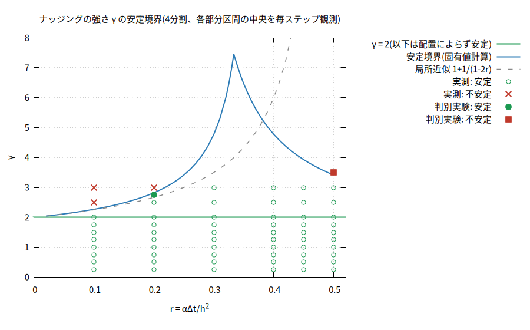

# ナッジングの安定性——理論と実験

作成: 2026-10-03。親文書「熱方程式の数値計算の安定性を固有値で調べる」(2026-10-03-stability-by-eigenvalues.md)の後半8を切り出し、理論展開と実験を詳しく書いたもの。図とデータは stability_figs/ にある。

## 0. 言葉の約束

- **担当計算機**: 区間 [0, 1] を部分区間に分けたとき、各部分区間を受け持って計算する小型計算機。本書では差分法(前進オイラー法)で計算する担当計算機を扱う。
- **観測点**: 温度を実際に測るセンサがある格子点。本書の実験では、各担当計算機が自分の部分区間の中央の格子点を1つずつ観測点として持つ。
- **ナッジング**: 観測のたびに、観測点の計算値 u を観測値 y に向けて

  u ← u + γ(y − u)

  と引き寄せる操作。γ は引き寄せの割合で、γ = 1 なら観測値で置き換え、0 < γ < 1 なら部分的に引き寄せる。データ同化(観測を数値計算に取り込む手法)の最も単純な方法の一つ。
- **r**: r = αΔt/h²。

## 1. 誤差の更新式

真の温度 u* も同じ差分法に従うとし、観測値を y = u*_i + ε(ε は観測ノイズ)とする。誤差 e = u − u* は、1ステップの計算で e ← Ge(G は前進オイラー法の更新行列、親文書 第3節と第10節)となり、続く観測点でのナッジングで

  e_i ← e_i + γ(y_i − u_i) = (1 − γ)e_i + γε_i

となる。観測点の位置だけ対角成分が1の対角行列を P とすると、毎ステップ観測する場合の誤差の更新は

  e^{m+1} = (I − γP) G e^m + γPε^m

と書ける。ノイズの項は外から加わる入力で、誤差が増大するかどうかは、入力のない部分の更新行列

  G' = (I − γP) G

で決まる。観測の周期が k ステップなら、k ステップ分の更新行列は (I − γP)G^k である。

## 2. 定理: γ ≤ 2 なら観測点の配置によらず増大しない

**主張**: r ≤ 1/2 かつ 0 ≤ γ ≤ 2 なら、観測点の数、位置、観測の周期によらず、誤差の最大値ノルム(全格子点での絶対値の最大)はステップを重ねても増えない。したがってスペクトル半径も1以下である。

**証明(行和ノルムによる)**: 行列の行和ノルム ‖M‖∞ を、各行の成分の絶対値の和の最大値とする。これはベクトルの最大値ノルムに対応する作用素ノルムで、‖Mx‖∞ ≤ ‖M‖∞‖x‖∞ が成り立つ。

- G の内部の行は (r, 1 − 2r, r) で、r ≤ 1/2 なら絶対値の和は r + (1 − 2r) + r = 1。両端が温度0に固定されている行は和が 1 − r で1以下。よって ‖G‖∞ ≤ 1。
- I − γP は対角行列で、観測点の対角成分が 1 − γ、それ以外が1。よって ‖I − γP‖∞ は「1 と |1 − γ| の大きいほう」で、0 ≤ γ ≤ 2 なら1以下。
- したがって ‖G'‖∞ ≤ ‖I − γP‖∞‖G‖∞ ≤ 1。誤差の最大値ノルムは増えない。

観測の周期が k の場合も、‖G^k‖∞ ≤ 1 なので同じく成り立つ。断熱(鏡映の仮想点を使うノイマン境界条件)の端の行も (1 − 2r, 2r) で和が1なので、同じ証明が通る。

**ゲルシュゴリンの定理による見方**: 観測点の行は (1 − γ) 倍されるので、その行の円は中心 (1 − γ)(1 − 2r)、半径 |1 − γ|·2r で、原点からの距離は最大でも |1 − γ| になる。他の行の円は単位円の内側にある。よって γ ≤ 2 なら、すべての固有値は単位円の内側にある。

**補足**:

- 当初の予想「0 < γ ≤ 1 なら安定条件を狭めない」は、この定理に含まれる。
- 定理は最大値ノルムが**一度も増えない**ことを言っており、固有値だけの議論より強い(途中の一時的な増大もない)。
- すべての格子点を観測する場合は I − γP = (1 − γ)I となり、スペクトル半径は |1 − γ| × (G のスペクトル半径)。G のスペクトル半径は1にごく近いので、γ がわずかでも2を超えると不安定になる。この意味で、γ ≤ 2 という境界は改善できない。

## 3. γ > 2 の安定境界

γ > 2 では観測点の行の和が1を超えるので、定理は使えない。安定かどうかは観測点の配置に依存する。

### 3.1 局所的な近似

観測点にだけ誤差 e がある状態を考える。1ステップの拡散で中心の誤差は (1 − 2r)e になり、ナッジングで (1 − γ) 倍される。周りに広がった誤差が戻ってくる効果を無視すると、1ステップで中心の誤差は (1 − γ)(1 − 2r) 倍になるので、安定の条件は |1 − γ|(1 − 2r) ≤ 1、すなわち

  γ ≤ 1 + 1/(1 − 2r)

である。r が小さいほど拡散が弱く、観測点での引き寄せすぎを周りに散らしきれないので、境界が下がる。

### 3.2 固有値の計算

格子点65個(内部点63個)、4分割で各部分区間の中央(格子点番号 8, 24, 40, 56 と仮定)を観測点とし、G' のスペクトル半径が1を超える最小の γ を r ごとに求めた。

| r | 0.10 | 0.20 | 0.25 | 0.30 | 1/3 | 0.40 | 0.45 | 0.50 |
|---|---|---|---|---|---|---|---|---|
| 安定境界の γ | 2.27 | 2.82 | 3.41 | 4.77 | 7.46(最大) | 4.77 | 3.93 | 3.41 |
| 局所近似 | 2.25 | 2.67 | 3.00 | 3.50 | 4.00 | 6.00 | 11.0 | 無限大 |

**読み取れること**:

- r が小さい側では、局所近似とよく合う。
- 安定境界は r = 1/3 付近で最も高くなり(約7.5)、その先は下がる。局所近似は r → 1/2 で無限大になるが、実際の境界は 3.41 まで下がる。
- r が 1/2 に近づくと、前進オイラー法の最も細かい成分(隣り合う格子点で符号が交互に変わる成分)の増幅因子が −1 に近づき、ほとんど減衰しなくなる。一方、γ > 2 のナッジングは観測点の誤差の符号を毎回反転させる。符号反転どうしの位相がそろい、この成分が観測点を通じて増大する。局所近似は周りから戻ってくる誤差を無視しているので、この効果を捉えられない。
- r = 1/3 は、更新式が3点の単純平均 (1/3, 1/3, 1/3) になる値で、観測点の誤差が周囲に最も均等に散らされる。境界がここで最も高くなる理由の直感的な説明だが、厳密な証明はしていない。

## 4. 実験

### 4.1 安定地図(2026-09-18)

- 設定: 4分割、全担当計算機が部分区間の中央を観測、毎ステップ観測、観測ノイズの標準偏差 0.05、2000ステップ、格子点65個。
- 掃引: γ ∈ {0.25, 0.5, 0.75, 1.0, 1.25, 1.5, 1.75, 2.0, 2.5, 3.0}、r ∈ {0.10, 0.20, 0.30, 0.40, 0.45, 0.50}。
- 判定: 最大誤差が10を超えるか、計算値が有限でなければ不安定。
- 実験の途中で、発散した計算の最大誤差が「数でない値」を無視する処理によって0と記録され、安定と誤判定される不具合が見つかり、修正された(修正前は偽の「安定」が2セルあった)。

結果(×が不安定):

| γ \ r | 0.10 | 0.20 | 0.30 | 0.40 | 0.45 | 0.50 |
|---|---|---|---|---|---|---|
| 0.25〜2.00 | 安定 | 安定 | 安定 | 安定 | 安定 | 安定 |
| 2.50 | × | 安定 | 安定 | 安定 | 安定 | 安定 |
| 3.00 | × | × | 安定 | 安定 | 安定 | 安定 |

### 4.2 理論との照合

60セルすべてについて G' のスペクトル半径を計算し、1を超えるかどうかで予測した結果は、**実測と全セルで一致した**。境界付近のセルの値:

| セル | スペクトル半径 | 予測 | 実測 |
|---|---|---|---|
| γ = 2.0、r = 0.10 | 0.9961 | 安定 | 安定 |
| γ = 2.5、r = 0.10 | 1.1848 | 不安定 | 不安定 |
| γ = 3.0、r = 0.10 | 1.5832 | 不安定 | 不安定 |
| γ = 3.0、r = 0.20 | 1.1048 | 不安定 | 不安定 |
| γ = 3.0、r = 0.30 | 0.9883 | 安定 | 安定 |

### 4.3 判別実験(2026-09-22)

安定地図の60セルでは、局所近似と固有値の計算のどちらでも同じ予測になり、両者を区別できない。そこで、2つの予測が食い違うセルを選んで追加で実験した(設定は 4.1 と同じ)。

| セル | 局所近似の予測 | 固有値計算の予測(スペクトル半径) | 実測 |
|---|---|---|---|
| γ = 2.75、r = 0.20 | 不安定(境界 2.67) | 安定(0.9922) | **安定**(最大誤差 0.69) |
| γ = 3.5、r = 0.50 | 安定(境界は無限大) | 不安定(1.0206) | **不安定**(最大誤差 4.4 × 10¹⁷) |

2セルとも固有値計算の予測どおりだった。特に2つ目は、r が 1/2 に近いときの符号反転の位相がそろう効果(第3.2節)が実在することを示している。

### 4.4 発散の大きさから増幅率を読む

2つ目のセルでは、2000ステップで最大誤差が 4.4 × 10¹⁷ になった。初期の誤差の大きさを E₀ とすると、1ステップあたりの拡大率は (4.4 × 10¹⁷ / E₀)^{1/2000} と推定できる(親文書 後半9)。

- E₀ = 1 とすると 1.0205
- E₀ = 0.05(観測ノイズの大きさ)とすると 1.0221

予測のスペクトル半径 1.0206 と、0.2%以内で一致する。ただし推定値が E₀ の仮定に依存するので、正確に照合するには、誤差の時系列を保存し、対数をとった誤差の傾きから拡大率を求める必要がある(親文書 後半9)。

## 5. 安定性以外の事柄(本書の範囲外)

- **ナッジングの効果**: 部分観測の計算(8分割のうち両端の2台ずつを置かない、観測周期10、2000ステップ)では、γ を大きくするほど観測している区間の最大誤差が下がった(断熱の境界で、γ = 0 の 8.076e-1 から γ = 1.0 の 3.114e-2 へ)。
- **最適な γ**: ナッジングは、ゲインを定数に固定したカルマンフィルタとみなせる。カルマンフィルタの定常ゲインは常に0と1の間に入るので、最適なナッジングは本書の定理の安全な範囲 γ ≤ 1 に自然に入る。最適な値は、観測ノイズの大きさと予測の誤差の大きさの比で決まる(カルマンフィルタの理論で扱う)。
- **学習型の担当計算機でのナッジング**: 観測点の1つの値だけを書き換える最小の形では、誤差は改善せず、わずかに悪化した。観測を損失関数の独立した項として加える方式が提案されている。

## 6. データと作図

**データの出所**: 実測の値は、報告書の表から壁打ち会話で手で転記したものである(生データの CSV からの読み込みではない)。理論の値(安定限界、スペクトル半径、安定境界)は、壁打ち会話の作業環境で更新行列の固有値を計算したもので、シミュレータの出力ではない。実測の図は、ローカルの CSV から直接作り直すことが望ましい。

| ファイル(stability_figs/) | 内容 |
|---|---|
| nudging_boundary.dat | r ごとの安定境界(固有値計算と局所近似) |
| nudging_cells.dat | 安定地図60セルと判別実験2セルの実測と予測のスペクトル半径 |
| nudging_boundary.gp | 作図のスクリプト |

出典: 観測点ナッジングの実装の報告書(2026-09-18)、理論予想の検証の報告書(2026-09-22)。
