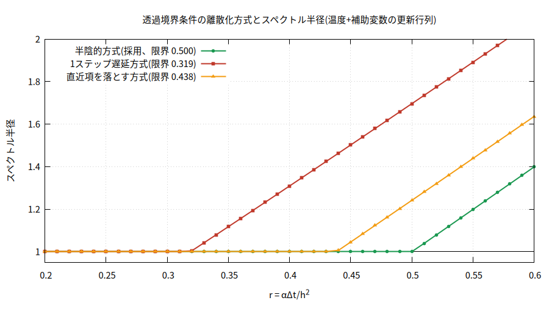

# 透過境界条件——導き方、安定性の理論、シミュレーション結果

作成: 2026-10-03。親文書「熱方程式の数値計算の安定性を固有値で調べる」(2026-10-03-stability-by-eigenvalues.md)の後半7を切り出したもの。導き方の部分は、以前の導出ノート(2026-09-13-transparent-boundary-derivation.md)を要約して再構成した。安定性の理論の部分は、本書で新たに更新行列の固有値を計算して確定させた。図とデータは stability_figs/ にある。

## 0. 位置づけ

担当計算機(部分区間を受け持つ小型計算機)が置かれていない区間との境目では、外側の温度が分からないので、何らかの仮定で境界条件を決める必要がある。

- **ディリクレ境界条件(温度0に固定)**: 外側を「熱をいくらでも吸い込む冷たい溜め」とみなす。熱が逃げすぎる。
- **ノイマン境界条件(断熱)**: 外側を「熱を一切通さない壁」とみなす。熱が逃げなさすぎる。
- **透過境界条件**: 外側に**同じ材質が無限に続いている**とみなす。本書の主題。

実際の外側はこの両極端の間にあり、透過境界条件はその間を物理法則に沿って埋める。

---

# 第I部 導き方

## 1. 浸透深さ

熱方程式 ∂u/∂t = α ∂²u/∂x² に現れる物理定数は熱拡散率 α(単位は 長さ²/時間)だけである。時間 t と組み合わせて作れる長さは √(αt) しかないので、時間 t の間に熱が届く深さ(浸透深さ)は √(αt) の程度になる。拡散を酔歩の極限とみなすと、変位の2乗平均が 2αt であることからも同じ結論になる。

## 2. 階段状の温度変化への応答

外側を x > 0 の半無限の区間とし、初期温度を0、境目 x = 0 の温度を時刻0で U₀ に上げてそのまま保つ。このときの厳密解は

  u(x, t) = U₀ · erfc( x / (2√(αt)) )

である(erfc は相補誤差関数)。境目での勾配を求めると、相補誤差関数の微分 erfc'(z) = −(2/√π)e^{−z²} より

  −∂u/∂x (0, t) = U₀ / √(παt)

となる。境目から外へ流れ出る量(勾配)は境目の温度 U₀ に比例し、その比例係数

  β(t) = 1 / √(παt)

は時間とともに小さくなる。「流れ出る量 = β × 境目の温度」という形はロバン境界条件と同じで、透過境界条件は**係数が時間とともに小さくなるロバン境界条件**とみなせる。時刻の初め(β が大きい)はディリクレ境界条件に近く、時間が経つ(β が小さくなる)とノイマン境界条件に近づく。外側に熱が染み込み、外側も温まってくると熱が逃げにくくなる、という物理の定量的な表現である。

## 3. 一般の温度の履歴への拡張

境目の温度が任意の履歴 g(t) をたどる場合は、ラプラス変換で解ける。外側の有界な解は û(x, s) = ĝ(s) e^{−x√(s/α)} で、境目での勾配は −û_x(0, s) = √(s/α) ĝ(s) となる。変換の世界での √s は、時間の世界では2分の1階の微分(半微分)にあたる。逆変換すると

  −∂u/∂x (0, t) = (1/√(πα)) ∫₀ᵗ g'(τ) / √(t − τ) dτ

これが半無限の媒質に対する厳密な透過境界条件である(境目の温度から境目の勾配への写像で、ディリクレ・ノイマン写像と呼ばれる)。g が階段関数のとき、第2節の結果に一致する。

**重要な性質**: 計算に必要なのは**自分の境目の温度の過去の履歴だけ**である。隣の担当計算機の値も、外側の区間の長さも要らない。各担当計算機が自分だけで計算できる。

## 4. 核 1/√t の指数和近似

第3節の積分を素直に計算すると、毎ステップ過去の履歴をすべてたどる必要があり、計算量と記憶量がステップ数とともに増える。これを避けるため、核 1/√t を指数関数の和で近似する。出発点は次の厳密な等式(ガンマ関数の積分表示)である。

  1/√t = (1/√π) ∫₀^∞ λ^{−1/2} e^{−λt} dλ

λ = e^{2x} と変数変換し、x について等間隔の台形公式で離散化すると

  1/√t ≈ Σ_{j=1}^{M} w_j e^{−λ_j t}

という M 項の和になる(λ_j = e^{2x_j}、w_j = (2/√π)·Δx·e^{x_j})。この近似は t が時間刻み Δt 以上の範囲で一様に成り立てばよい(差分計算は Δt より短い時間差の核を使わないため)。

基準設定(Δt = 1e-4、2000ステップ、時間範囲0.2)での精度:

| 刻み Δx | 項数 M | 相対誤差の最大 |
|---|---|---|
| 1.0 | 20 | 2.0e-2 |
| 0.8 | 24 | 5.9e-3 |
| 0.6 | 32 | 7.7e-4 |
| 0.4 | 48 | 3.9e-5 |

## 5. 補助変数の漸化式

指数関数には e^{−λ(a+b)} = e^{−λa}e^{−λb} という性質(半群性)がある。これを使うと、補助変数

  y_j(t) = ∫₀ᵗ e^{−λ_j(t − τ)} dg(τ)

は、直前の値と、そのステップでの境目の温度の変化量 Δg だけから更新できる。

  y_j^{m+1} = e^{−λ_j Δt} · y_j^m + e^{−λ_j Δt/2} · Δg^m

  境目の勾配 ≈ (1/√(πα)) Σ_j w_j y_j

直感的には、忘れる速さ λ_j の異なる M 個の「水漏れするバケツ」に境目の温度変化を注ぎ、その合計で長い記憶を表している。速く漏れるバケツが最近の履歴を、ゆっくり漏れるバケツが遠い過去を受け持つ。

**数値検証**: 温度の履歴 g(t) = sin(20t) について、全履歴をたどる直接計算と、M = 48 の漸化式を比べると、相対差の最大は 9.1e-6 だった。演算量は直接計算の約200万回に対し、漸化式は約9.6万回である。実機では、物理単位での運転(α = 1e-3、Δt = 1秒)で補助変数25個を使っている(実装上の上限は64個)。

## 6. 仮定と有効範囲

- **材質の連続**: 境目の外側に、観測している区間と同じ熱拡散率の材質が続いている。
- **外側の初期状態**: 透過境界条件を使い始めた時点で、外側の温度が境目の付近と同程度である(外側が最初から極端に熱い、または冷たい場合の情報は、履歴からは得られない)。
- **外側の区間の長さ**: 実際の外側は無限ではない。浸透深さ √(αt) が外側の区間の幅を超えると、外側の端の影響が届き、半無限の仮定が破れる。周期的に変動する温度に対しては、浸透深さは時間とともに伸びず、周期 P に対して √(αP/π)(表皮深さ)で頭打ちになるので、この長さが外側の区間の幅より小さければ仮定は保たれ続ける(後者は理論上の見立てで、実データでの確認は今後)。

---

# 第II部 時間方向の離散化と安定性の理論

## 7. 境目の更新式

境目の外側に、内側の点の値を鏡に映した仮想の点を置き、そこに外へ流れ出る熱の量を加える形で、境目の格子点の更新式は次のようになる(前進オイラー法、r = αΔt/h²)。

  u_0^{m+1} = u_0^m + 2r(u_1^m − u_0^m) − (2rh/α)·q

ここで q は外へ流れ出る熱流束(熱拡散率 × 外向きの勾配)で、第5節の補助変数から計算する。

## 8. 直近1ステップの寄与が特別に大きい

第5節の和のうち、直近1ステップの温度変化に掛かる係数は

  κ = √(α/π) Σ_j w_j e^{−λ_j Δt/2} ≈ √(2α/(πΔt))

で、Δt を小さくするほど大きくなる(Δt の平方根に反比例)。外側の「まだ温まっていない直近の層」は、ディリクレ境界条件のように硬く応答する、という物理の表れである。この項をどう扱うかで、3つの方式がありうる。

| 方式 | 直近1ステップの寄与の扱い |
|---|---|
| **半陰的方式**(採用) | 当ステップの境目の温度変化 (u_0^{m+1} − u_0^m) に κ を掛けた項を、新しい値について解く(陰的)。過去の分は補助変数で陽的に計算する |
| **1ステップ遅延方式** | 前のステップで計算し終えた流束を、そのまま次のステップで使う。直近の寄与は1ステップ遅れて反映される |
| **直近項を落とす方式** | 補助変数を減衰させた過去の分だけを使い、当ステップの寄与を一度も使わない |

## 9. 更新行列とスペクトル半径

3方式とも1ステップの写像は線形なので、**温度(63個)と補助変数(M 個)をまとめた状態**の更新行列を作れる。作り方は、状態の i 番目だけが1のベクトルに写像を1回当てた結果を i 列目とする(親文書 後半9)。その行列のスペクトル半径を r ごとに計算した。設定は、左端が透過境界条件、右端が温度0、格子点65個、指数和は時間範囲0.2で構成(補助変数55〜56個)。

| 方式 | 安定限界 r |
|---|---|
| 半陰的方式(採用) | **0.500** |
| 1ステップ遅延方式 | **0.319** |
| 直近項を落とす方式 | **0.438** |

安定な範囲でスペクトル半径が1にごく近い(1 − 4×10⁻¹³ 程度)のは、非常にゆっくり忘れる補助変数の固有値が1にわずかに届かない値だからで、1を超えてはいない。

## 10. 不安定な成分の形

限界を超えたところで、絶対値最大の固有値の固有ベクトルを調べた。

| 方式と r | 絶対値最大の固有値 | 温度の成分のうち境目から5点以内にある割合 |
|---|---|---|
| 1ステップ遅延方式、r = 0.35 | −1.118 | ほぼ100% |
| 直近項を落とす方式、r = 0.46 | −1.085 | ほぼ100% |
| 半陰的方式、r = 0.51 | −1.039 | ほぼ0% |

1ステップ遅延方式と直近項を落とす方式の不安定は、**境目に局在し、1ステップごとに符号を反転しながら増大する**。境目で「温度が上がる → 流れ出る熱が増える → 温度が下がる」という負のフィードバックが、硬い直近の寄与の扱いの遅れや欠落によって行き過ぎ、振動が増大するものである。

半陰的方式で r > 0.5 に現れる不安定は、境目ではなく**区間の内部に広がる**鋸歯状の成分で、前進オイラー法そのものの不安定(親文書 第7節)である。つまり**半陰的方式の透過境界条件は、差分法の時間刻みの上限 r ≤ 1/2 に新しい制約を加えない**。

## 11. 安定限界が r だけで決まる理由

境目の更新式で、直近の寄与によるフィードバックの強さは、係数 (2rh/α)·κ で表される。κ ≈ √(2α/(πΔt)) と Δt = rh²/α を代入すると

  (2rh/α)·κ ≈ 2√(2r/π)

となり、h にも Δt にもよらず、**r だけの関数**になる。したがって安定限界も r の特定の値として現れる。正確な値はこの粗い見積もりでは決まらず、第9節の行列の計算で求めた。

## 12. ゲルシュゴリンの定理が使えない理由

ディリクレ境界条件とノイマン境界条件では、温度だけの更新行列にゲルシュゴリンの定理を当てはめて、r ≤ 1/2 で安定であることを示せる(親文書 後半5)。透過境界条件では、状態に補助変数が加わり、境目の行が補助変数の列にも成分を持つので、温度だけの行列での議論は使えない。補助変数を含めた行列で、行の非対角成分の和が大きくなる場合もあり、定理による見積もりは粗くなる。そのため本書では、行列の固有値を直接計算した。

---

# 第III部 シミュレーション結果

## 13. 差分法の担当計算機での確認

- 半陰的方式は、r = 0.49、8000ステップで安定だった(実装側の確認)。第9節の限界 0.500 と整合する。
- 数学の検討の過程で行った数値実験(時刻0.2まで、r の刻みは粗い)では、1ステップ遅延方式は r = 0.30 で発散せず r = 0.35 で発散し、直近項を落とす方式は r = 0.41 で安定だった。第9節の限界 0.319 と 0.438 と整合する。

## 14. 学習型の担当計算機に透過境界条件を課す方式

学習型の担当計算機(ニューラルネットワークで部分区間の温度分布を表し、最適化で求める担当計算機)では、実装の過程で次の経緯があった(実装側の報告)。

1. 流れ出る熱流束を陽的な目標として損失関数に加えた方式では、最大誤差が 1.5 という大きな乱れが出た。陽的な流束目標が第8節の1ステップ遅延方式に近い扱いであれば、第10節の境目のフィードバックの不安定で説明できる(どちらの方式に当たるかは未確認)。
2. 半陰的な式で境目の**値**の目標を作り、それに合わせる方式に変えたところ、最大誤差は 1.6e-3 に回復した。半陰的な流束の条件と値の目標は、同じ1本の線形の関係式をどちらの変数について解くかの違いなので、透過境界条件の意味(半無限の媒質のディリクレ・ノイマン写像)は保たれる。
3. さらに、補助変数の更新に、目標値ではなく最適化の結果として実際に得られた境目の値の変化を使うよう修正したところ、最大誤差は 6.4e-4 に下がった。
4. 階段状の入力に対しては、漸化式に時間の離散化による誤差がないこと(第5節の半群性)を確認した。
5. 陽的な扱いと半陰的な扱いの計算結果の差は、Δt を半分にするとちょうど半分になった(差は Δt に比例する)。

## 15. 物理的な妥当性に関わる比較

安定性ではなく、どれだけ正しい温度を与えるかについての比較である。

**部分観測の計算(8分割のうち両端の2台ずつを置かない、2000ステップ、観測している区間の最大誤差)**: ナッジング(観測点の値を観測値へ引き寄せる操作、別文書参照)の強さ γ ごと。

| γ | 断熱 | 透過境界条件 |
|---|---|---|
| 0(ナッジングなし) | 8.076e-1 | 6.772e-1 |
| 0.1 | 2.122e-1 | 4.126e-1 |
| 0.3 | 6.672e-2 | 2.486e-1 |
| 1.0 | 3.114e-2 | 1.449e-1 |

ナッジングなしでは透過境界条件が良いが、ナッジングありでは断熱が良くなった。

**物理単位での予行演習(4台のうち1台を置かない、周期600秒で変動する温度場)**: 1台を「観測値を計算に取り込まず、予測の評価だけに使う台」とし、その台での「計算による予測と観測の差」の平均を、「他の台の観測値の平均で代用する単純な予測と観測の差」の平均で割った比率を見た(小さいほど計算による予測が優れている)。結果は、前半900秒で断熱 0.34、透過境界条件 0.33。全2000秒で断熱 0.47、透過境界条件 0.43。この構成では透過境界条件がわずかに良く、差は全体で見るほうが開いた。周期的な温度場では浸透深さが表皮深さで頭打ちになり、半無限の仮定が保たれ続ける(第6節)ことと整合する、というのが理論側の解釈である(未検証)。

## 16. 未解決の事柄

- 透過境界条件がエネルギーの意味で安定であること(熱を生み出さないこと)の理論的な証明。境目の写像が受動的であること(流れ出る熱の時間積分が負にならないこと)から示す道筋を考えている。
- ナッジングと組み合わせたときに断熱が有利になる理由の切り分け(時間帯の問題か、誤差の空間的な形の問題か)。
- 2つ目以降の境目(両側に担当計算機のない区間がある場合)や、担当計算機の参加・離脱で境目が動く場合の扱い。

## 17. データと作図

**データの出所**: 実測の値は、報告書の表から壁打ち会話で手で転記したものである(生データの CSV からの読み込みではない)。理論の値(安定限界、スペクトル半径、安定境界)は、壁打ち会話の作業環境で更新行列の固有値を計算したもので、シミュレータの出力ではない。実測の図は、ローカルの CSV から直接作り直すことが望ましい。

| ファイル(stability_figs/) | 内容 |
|---|---|
| transparent_rho.dat | 3方式のスペクトル半径(r = 0.20〜0.60) |
| transparent_rho.gp | 作図のスクリプト |

出典: 透過境界条件の導出ノート(2026-09-13)、観測点ナッジングの実装の報告書(2026-09-18)、理論予想の検証と実験1の準備の報告書(2026-09-22)、実装側からの報告(2026-09中旬、学習型への課し方)。
